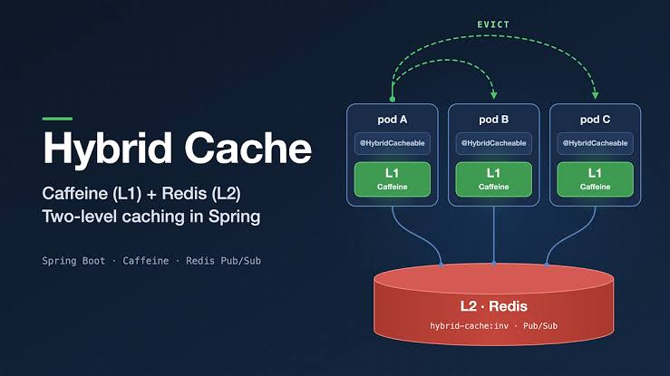

# BiteSync Phase 3 (Sprint 3A): `restaurant-service` Architecture & Caching Guide

> **Purpose:** A complete, beginner-friendly yet production-grade architectural reference for **Sprint 3A (`restaurant-service`, Port `8082`)**. Keep this document inside `bitesync-docs/` as your quick refresher for system design concepts, MongoDB modeling, L1 + L2 hybrid caching, RBAC onboarding, and your step-by-step implementation order.

---

## Table of Contents
1. [Phase 3 Overview & Running Example](#1-phase-3-overview--running-example)
2. [Polyglot Persistence & MongoDB Data Modeling](#2-polyglot-persistence--mongodb-data-modeling)
3. [CAP Theorem & Consistency Trade-offs](#3-cap-theorem--consistency-trade-offs)
4. [MongoDB Indexing (ESR Rule) & Pagination](#4-mongodb-indexing-esr-rule--pagination)
5. [Multi-Tier Hybrid Caching: L1 (Caffeine) + L2 (Redis) + Pub/Sub](#5-multi-tier-hybrid-caching-l1-caffeine--l2-redis--pubsub)
6. [Caching Strategies Compared & Why We Evict on Write](#6-caching-strategies-compared--why-we-evict-on-write)
7. [Three Production Caching Traps (and How BiteSync Prevents Them)](#7-three-production-caching-traps-and-how-bitesync-prevents-them)
8. [Domain Blueprint, RBAC Security & Onboarding Flow](#8-domain-blueprint-rbac-security--onboarding-flow)
9. [Integrating with Your Existing BiteSync Codebase (Build Order)](#9-integrating-with-your-existing-bitesync-codebase-build-order)
10. [Quick-Reference Glossary](#10-quick-reference-glossary)

---

## 1. Phase 3 Overview & Running Example

Phase 3 splits BiteSync's core business domain into two focused sprints:

* **Sprint 3A — `restaurant-service` (Port `8082`):** Polyglot persistence with MongoDB, compound indexing & cursor pagination, L1 (Caffeine) + L2 (Redis) + Redis Pub/Sub hybrid caching, and the restaurant onboarding workflow (`PENDING_APPROVAL` $\rightarrow$ `ACTIVE`) secured by your Phase 2 JWT RBAC.
* **Sprint 3B — `order-service` (Port `8083`):** Apache Kafka, Transactional Outbox Pattern, Choreography Saga, CQRS, and API Idempotency.

### Our Running Real-World Scenario
To make every concept concrete, imagine it is **Friday night at 8:00 PM in Bengaluru**. Thousands of hungry BiteSync customers are opening the app to browse restaurants and order from **Spice Route Biryani**, which is running a flash sale.

---

## 2. Polyglot Persistence & MongoDB Data Modeling

**Polyglot Persistence** simply means *using the right type of database for the right workload* rather than forcing a single database to do everything poorly.

### Why MongoDB for Menus Instead of PostgreSQL?
* **`user-service` & `order-service` (PostgreSQL):** User accounts, roles, payments, and orders require strict relational integrity and ACID transactions.
* **`restaurant-service` (MongoDB):** A restaurant menu has the opposite access pattern: **$95\%+$ reads**, **$< 5\%$ writes**, and deeply nested hierarchical data:
  `Restaurant` $\rightarrow$ `Menu Categories` $\rightarrow$ `Menu Items` $\rightarrow$ `Add-ons / Customizations`.

```text
  POSTGRESQL (Relational - Users & Orders)      MONGODB (Document - Restaurant Menus)
  ┌──────────────┐  ┌───────────────────┐       ┌────────────────────────────────────────┐
  │ restaurants  │──│  menu_categories  │       │ {                                      │
  └──────────────┘  └─────────┬─────────┘       │   "_id": "65f1a29b4c8e12001a9c4b11",   │
                              │                 │   "name": "Spice Route Biryani",       │
                    ┌─────────▼─────────┐       │   "city": "Bengaluru",               │
                    │    menu_items     │       │   "status": "ACTIVE",                  │
                    └─────────┬─────────┘       │   "rating": 4.7,                       │
                              │                 │   "menuCategories": [                  │
                    ┌─────────▼─────────┐       │     { "name": "Biryani", "items": [    │
                    │    item_addons    │       │         { "name": "Chicken Biryani",   │
                    └───────────────────┘       │           "price": 320,                │
                                                │           "addons": ["Extra Raita"] }  │
  [X] Needs 4-5 table JOINs on every browse     │       ] }                              │
                                                │   ]                                    │
                                                │ }                                      │
                                                └────────────────────────────────────────┘
                                                [OK] 1 single BSON document = 0 JOINs
```

* **What is BSON?** Binary JSON. MongoDB stores documents in a compact binary representation of JSON so it can parse, traverse, and index fields much faster than plain text JSON.
* **Key Payoff:** One indexed lookup returns the entire restaurant and menu payload in a single round trip with zero JOINs.

### Concrete Document Blueprint (`restaurants` Collection in `bitesync_menus`)

```json
{
  "_id": "65f1a29b4c8e12001a9c4b11",
  "ownerId": "d290f1ee-6c54-4b01-90e6-d701748f0851",
  "name": "Spice Route Biryani",
  "city": "Bengaluru",
  "cuisineTypes": ["Biryani", "North Indian", "Mughlai"],
  "status": "ACTIVE",
  "rating": 4.7,
  "menuCategories": [
    {
      "name": "Signature Biryanis",
      "items": [
        {
          "itemId": "item-101",
          "name": "Hyderabadi Chicken Dum Biryani",
          "price": 320.00,
          "isAvailable": true
        },
        {
          "itemId": "item-102",
          "name": "Paneer Subz Biryani",
          "price": 270.00,
          "isAvailable": true
        }
      ]
    }
  ],
  "createdAt": "2026-11-19T14:30:00Z",
  "updatedAt": "2026-11-19T15:00:00Z"
}
```

---

## 3. CAP Theorem & Consistency Trade-offs

When a system runs across multiple database nodes, network links occasionally glitch and nodes temporarily lose contact with each other. That split is called a **Network Partition (P)**.

The **CAP Theorem** states that during a Partition (P), a distributed data store must choose between:
1. **Consistency (C) $\rightarrow$ CP:** *"Never serve stale or conflicting data. Block or reject requests until every required node agrees on the latest truth."*
2. **Availability (A) $\rightarrow$ AP (Eventual Consistency):** *"Always answer the user immediately, even if the data is a few seconds behind the latest write."*

### CAP Posture Across BiteSync Services

| Service | Database | CAP Posture | Why It Fits |
| :--- | :--- | :--- | :--- |
| **`user-service` / `order-service`** | PostgreSQL | **CP** (Strong Consistency / ACID) | A double-charged payment or letting a revoked/banned user log in is unacceptable. Better to fail/block than serve wrong truth. |
| **`restaurant-service`** | MongoDB + L1/L2 Cache | **CP on writes** / **Tunable AP on reads** | MongoDB routes writes to the primary (CP). Putting Caffeine + Redis in front of reads means a browsing customer might see a ₹10 price change 30 seconds late—a completely acceptable trade-off to achieve **$< 5\text{ ms}$ latency at $10,000+\text{ req/sec}$** (real prices are always re-verified at checkout). |

---

## 4. MongoDB Indexing (ESR Rule) & Pagination

Poor indexing and naive pagination work fine with 50 test records—and silently destroy performance in production with 50,000+ restaurants.

### A. The ESR Rule for Compound Indexes (`Equality -> Sort -> Range`)

Suppose a user searches: *"Show me all `ACTIVE` restaurants in `Bengaluru`, sorted by highest `rating`."*

Without an index, MongoDB performs a **Collection Scan** (reads every single restaurant document one by one). When you create a multi-field (**compound**) index, order the fields strictly by **E $\rightarrow$ S $\rightarrow$ R**:

1. **E — Equality (Exact matches first):** `city = "Bengaluru"`, `status = "ACTIVE"`
2. **S — Sort (Ordering fields next):** `rating` descending (`-1`)
3. **R — Range (Inequality filters last):** e.g., `deliveryTime < 30` or `price <= 400`

**BiteSync Compound Index:**
```javascript
{ city: 1, status: 1, rating: -1 }
```
Because the B-Tree index is pre-sorted in this exact order, MongoDB jumps straight to Bengaluru's active restaurants and reads them already sorted from highest to lowest rating—avoiding expensive in-memory sorting.

### B. Offset Pagination vs. Cursor (Keyset) Pagination

How should BiteSync load Page 1, Page 2, ..., Page 500 when a customer scrolls through restaurants?

```text
  [X] OFFSET PAGINATION (?page=500&size=20)
  ┌───┬───┬───┬───────────────────────────────┬──────────────────┐
  │ 1 │ 2 │ 3 │ ... scans & discards 10,000!  │ [10001 .. 10020] │ <-- Gets slower every page!
  └───┴───┴───┴───────────────────────────────┴──────────────────┘
  Extra bug: If a new restaurant is inserted at #1 while you scroll,
  item #20 shifts to #21 and shows up twice on the next page!

  [OK] CURSOR / KEYSET PAGINATION (?afterId=rest_10000&size=20)
  B-Tree jumps directly to bookmark [rest_10000] ---> grabs next 20 [10001 .. 10020]
  Time complexity: O(log N) regardless of whether you are on page 1 or page 500!
```

* **Offset (`skip` / `limit`):** Latency degrades linearly ($O(\text{offset})$) as pages get deeper, and concurrent inserts/deletes cause duplicate or skipped records.
* **Cursor (`_id > lastObjectId`):** Passes the last seen ID as a bookmark. MongoDB seeks straight to that entry in the B-Tree in $O(\log N)$ time, giving constant-feel latency at any depth. In `restaurant-service`, we implement cursor-aware queries alongside standard pageable listings.

---

## 5. Multi-Tier Hybrid Caching: L1 (Caffeine) + L2 (Redis) + Pub/Sub




Why use **two** cache layers instead of just one?
* **Only Redis (L2):** Still pays a TCP network hop + JSON serialization/deserialization on every request (~1–2 ms) and can become a network bottleneck during massive spikes.
* **Only Caffeine (L1):** Runs inside JVM heap RAM (< 0.1 ms), but loses everything on pod restart and cannot share warm data across multiple scaled pods.
* **Hybrid L1 + L2:** Combines microsecond local RAM speed with a shared cluster cache across all pods.

### The Restaurant Kitchen Analogy
* **L1 Cache — Caffeine (Sticky note on a chef's own apron):** Ultra-fast ($< 0.1\text{ ms}$), zero network hop. Small capacity (e.g., max 500 restaurants, TTL 1–2 min). Private to that single pod.
* **L2 Cache — Redis (Shared whiteboard in the middle of the kitchen):** Fast ($\sim 1\text{--}2\text{ ms}$), shared by every running pod of `restaurant-service`. Larger capacity (TTL 30 min, JSON).
* **Redis Pub/Sub (The kitchen intercom / PA system):** Instant broadcast channel so when one pod updates a menu, every other pod hears `"EVICT"` and wipes its local sticky note immediately.
* **MongoDB (The main storage warehouse):** Permanent source of truth on disk ($\sim 10\text{--}50\text{ ms}$).

### Diagram 1: Single-Request Read Path (Cache Lookup Hierarchy)

```text
                       HTTP GET /api/restaurants/{id}
                                     |
                                     v
                    ┌────────────────────────────────┐
                    │   restaurant-service (Pod A)   │
                    │  ┌──────────────────────────┐  │
                    │  │   L1: Caffeine (JVM RAM) │  │ -- HIT (< 0.1 ms) --> Return Menu
                    │  │   Max: 500 | TTL: 2 min  │  │
                    │  └────────────┬─────────────┘  │
                    └───────────────┼────────────────┘
                                    | L1 Miss (Not on local apron)
                                    v
                    ┌────────────────────────────────┐
                    │     L2: Redis (Shared TCP)     │ -- HIT (~1-2 ms) --> Populate L1 --> Return
                    │     TTL: 30 min (JSON)         │
                    └───────────────┬────────────────┘
                                    | L2 Miss (Not on shared whiteboard)
                                    v
                    ┌────────────────────────────────┐
                    │      MongoDB (Disk / BSON)     │ -- Query (~10-50 ms) --> Populate L2 & L1 --> Return
                    └────────────────────────────────┘
```

### Diagram 2: Full Multi-Pod L1 Caffeine + L2 Redis + Redis Pub/Sub Hybrid Architecture

When BiteSync scales `restaurant-service` across multiple instances (`Pod A`, `Pod B`, `Pod C`), all pods share L2 Redis and stay synchronized via Redis Pub/Sub eviction broadcasts:

```text
                           [ Clients / API Gateway ]
                                       |
                        (Load Balanced HTTP Requests)
                     ┌─────────────────┼─────────────────┐
                     v                 v                 v
             ┌───────────────┐ ┌───────────────┐ ┌───────────────┐
             │     Pod A     │ │     Pod B     │ │     Pod C     │
             │ ┌───────────┐ │ │ ┌───────────┐ │ │ ┌───────────┐ │
             │ │ L1 Cache  │ │ │ │ L1 Cache  │ │ │ │ L1 Cache  │ │
             │ │(Caffeine) │ │ │ │(Caffeine) │ │ │ │(Caffeine) │ │
             │ │TTL: 2 min │ │ │ │TTL: 2 min │ │ │ │TTL: 2 min │ │
             │ └─────┬─────┘ │ │ └─────┬─────┘ │ │ └─────┬─────┘ │
             └───┬───┴───▲───┘ └───┬───┴───▲───┘ └───┬───┴───▲───┘
                 |       |         |       |         |       |
       Read/Write|       |EVICT    |       |EVICT    |       |EVICT
       (L1 Miss) |       |(Sub)    |       |(Sub)    |       |(Sub)
                 v       |         v       |         v       |
             ┌───────────┴─────────┴───────┴─────────┴───────┴───┐
             │                  SHARED L2 REDIS                  │
             │  ┌─────────────────────┐  ┌────────────────────┐  │
             │  │   Key-Value Cache   │  │   Redis Pub/Sub    │  │
             │  │   TTL: 30 min JSON  │  │ Channel:           │  │
             │  │  (Shared across all │  │ cache:evict:       │  │
             │  │        pods)        │  │ restaurant:{id}    │  │
             │  └──────────┬──────────┘  └────────────────────┘  │
             └─────────────┼─────────────────────────────────────┘
                           | L2 Miss (Reads) / Writes (Source of Truth)
                           v
             ┌───────────────────────────────────────────────────┐
             │                MongoDB (bitesync_menus)           │
             │          Permanent BSON Document Storage          │
             └───────────────────────────────────────────────────┘

  Write Flow Example (Owner edits Spice Route Biryani menu on Pod A):
  1. Pod A writes updated menu document to MongoDB.
  2. Pod A deletes key from L2 Redis + deletes its own L1 Caffeine entry.
  3. Pod A publishes "cache:evict:restaurant:101" to Redis Pub/Sub.
  4. Pod B & Pod C receive the Pub/Sub message in milliseconds and evict key 101 from their L1 Caffeine!
```

---

## 6. Caching Strategies Compared & Why We Evict on Write

### Comparison of the 4 Standard Caching Patterns

| Strategy | Read Path | Write Path | Pros | Cons / Pitfalls |
| :--- | :--- | :--- | :--- | :--- |
| **Cache-Aside (Lazy Loading)** *(BiteSync Choice)* | App checks Cache $\rightarrow$ on miss, reads DB & populates Cache. | App writes to DB, then **evicts (deletes)** the cache key. | Only hot/popular restaurants consume RAM; if Redis goes down, app gracefully falls back to MongoDB. | First read after an update is a cold miss; brief inconsistency if eviction fails. |
| **Read-Through** | App calls Cache only; Cache itself queries DB on miss. | Same as Cache-Aside or paired with Write-Through. | Cleaner application service code. | Requires a cache plugin tightly coupled to the database. |
| **Write-Through** | Always hits warm Cache. | App writes to Cache, which synchronously writes to DB before returning. | Strong Cache/DB sync; zero cold reads right after a write. | Higher write latency; wastes RAM caching cold data nobody ever views. |
| **Write-Behind (Write-Back)** | Always hits warm Cache. | App writes to Cache (returns immediately); async batch flushes to DB later. | Massive write throughput (great for live delivery rider GPS pings or view counters). | **Data loss risk** if Redis crashes before flushing queued writes to disk. |

### Why Evict (Delete) Instead of Update the Cache on Write?

Suppose the owner of Spice Route Biryani accidentally saves Chicken Biryani at **₹250** (Request A), then 1 millisecond later fixes it to **₹350** (Request B). Network scheduling can make their cache updates arrive out of order:

```text
  [X] DANGER OF "UPDATE CACHE ON WRITE" (Race Condition)
  t = 1ms : Request A writes ₹250 to MongoDB
  t = 2ms : Request B writes ₹350 to MongoDB        --> MongoDB Truth = ₹350 [OK]
  t = 3ms : Request B updates Redis to ₹350
  t = 4ms : Request A (delayed) updates Redis ₹250  --> Redis STUCK at ₹250! [BUG]

  [OK] WHY "EVICT (DELETE) ON WRITE" WINS
  t = 1ms : Request A writes ₹250 to MongoDB --> Evicts Redis key
  t = 2ms : Request B writes ₹350 to MongoDB --> Evicts Redis key
  t = 3ms : Next customer requests menu --> Cache miss --> Reads exact truth (₹350) from MongoDB & caches it!
```

---

## 7. Three Production Caching Traps (and How BiteSync Prevents Them)

### Trap 1: Cross-Instance Stale L1 Cache
* **The Problem:** Owner updates a menu $\rightarrow$ request hits **Pod A**. Pod A updates MongoDB, deletes L2 Redis, and clears its own L1 Caffeine. **Pod B** has no idea and continues serving the old menu from its local L1 RAM until its TTL expires.
* **BiteSync's Fix:**
  1. Keep L1 Caffeine TTL very short (**1–2 minutes**) as a safety net.
  2. Broadcast a lightweight **Redis Pub/Sub** message (`cache:evict:restaurant:{id}`) on every write so every running pod immediately evicts that key from its local Caffeine map.

### Trap 2: Cache Stampede (Thundering Herd)
* **The Problem:** At 8:00:00 PM sharp, Spice Route Biryani's 30-minute Redis TTL expires. In that exact millisecond, **500 concurrent users** tap the restaurant. All 500 miss L1 and L2 simultaneously and slam MongoDB with 500 identical queries, spiking CPU to $100\%$.

```text
  500 Concurrent Requests (Cache Key Just Expired!)
                   |
                   v
    ┌─────────────────────────────┐
    │ Single-Flight Lock (sync)   │
    │  - Thread #1  ---> Queries MongoDB once (~20ms) ---> Populates Cache
    │  - Threads #2..#500 ---> Wait on Thread #1's result ---> Receive same menu!
    └─────────────────────────────┘
```

* **BiteSync's Fix:**
  1. **Single-Flight Locking:** Use `sync = true` in Spring Cache / Caffeine's `get(key, loader)` so only **1 thread per pod** queries downstream while the other 499 wait on the same future and share the response.
  2. **TTL Jitter:** Add small randomness to L2 TTLs (e.g., $30\text{ min} + \text{random}(0\text{--}180\text{ sec})$) so keys loaded together never all expire at the exact same second.

### Trap 3: Cache Penetration
* **The Problem:** A malicious bot fires 10,000 requests for non-existent IDs like `/api/restaurants/fake-id-999999`. Because fake IDs are never in L1 or L2, every single request punches straight through both caches and hammers MongoDB.
* **BiteSync's Fix:**
  1. **Boundary Validation (`@Valid`):** Reject malformed MongoDB ObjectIds right at the controller before touching Redis or MongoDB.
  2. **Short-TTL Negative Caching:** If a valid-looking ObjectId truly doesn't exist in MongoDB, cache a lightweight `"NOT_FOUND"` sentinel marker in Redis for **30 seconds** so repeated bot hits bounce harmlessly off Redis.

---

## 8. Domain Blueprint, RBAC Security & Onboarding Flow

`restaurant-service` connects directly to the Phase 2 RBAC model built in `user-service` (`CUSTOMER`, `RESTAURANT_OWNER`, `ADMIN`).

### JWT `sub` (Subject) Security Rule
Inside the RSA-signed JWT issued by `user-service`, the `sub` claim contains the logged-in user's immutable UUID.
* **Golden Rule:** Always extract `ownerId` from the verified JWT `sub` claim—**never** accept or trust `ownerId` from the incoming JSON request body. Otherwise, a malicious caller could register or overwrite someone else's restaurant simply by changing one JSON field.

### Restaurant Onboarding & Menu Management Lifecycle

```text
  STEP 1: APPLY (CUSTOMER)          STEP 2: APPROVE (ADMIN)           STEP 3: EDIT MENU (OWNER)
  POST /api/restaurants/apply       PATCH /api/restaurants/{id}/      PUT /api/restaurants/{id}/menu
                                          approve
  ┌───────────────────────────┐     ┌───────────────────────────┐     ┌───────────────────────────┐
  │ Auth: Authenticated User  │     │ Auth: @PreAuthorize       │     │ Auth: RESTAURANT_OWNER    │
  │                           │     │   ("hasRole('ADMIN')")    │     │   + Ownership Check:      │
  │ ownerId = jwt.getSubject()│────>│                           │────>│   restaurant.ownerId      │
  │ status  = PENDING_APPROVAL│     │ status = ACTIVE           │     │     .equals(jwt.subject)  │
  │                           │     │ Evicts L2 + Pub/Sub L1    │     │ Updates MongoDB           │
  │ (Not visible to public)   │     │ (Now live for browsing!)  │     │ Evicts L2 + Pub/Sub L1    │
  └───────────────────────────┘     └───────────────────────────┘     └───────────────────────────┘
```

### Endpoint & Security Boundary Reference

| HTTP Method & Endpoint | Required Role / Access | Caching & Behavior |
| :--- | :--- | :--- |
| `GET /api/restaurants` | Public / `CUSTOMER` | Returns `ACTIVE` restaurants; supports ESR-indexed city/rating filtering + cursor (`afterId`) pagination. |
| `GET /api/restaurants/{id}` | Public / `CUSTOMER` | Served via **L1 Caffeine $\rightarrow$ L2 Redis $\rightarrow$ MongoDB** with single-flight lock + negative caching. |
| `POST /api/restaurants/apply` | Authenticated `CUSTOMER` | Creates restaurant in `PENDING_APPROVAL` status; binds `ownerId` strictly from JWT `sub`. |
| `PATCH /api/restaurants/{id}/approve` | `ADMIN` only (`@PreAuthorize`) | Transitions status to `ACTIVE`; evicts L2 Redis + publishes L1 Pub/Sub invalidation. |
| `PUT /api/restaurants/{id}/menu` | `RESTAURANT_OWNER` + Ownership Check | Verifies `restaurant.ownerId.equals(jwt.subject)`, updates embedded menu in MongoDB, evicts L2 + broadcasts L1 Pub/Sub invalidation. |

---

## 9. Integrating with Your Existing BiteSync Codebase (Build Order)

Your Phase 1 & Phase 2 monorepo already has `discovery-server`, `api-gateway`, `user-service`, and `bitesync-common` compiled and tested.

### Pre-Flight Integration Checklist
1. **Stateless JWT Verification in `restaurant-service`:** Configure `restaurant-service` as a Spring OAuth2 Resource Server using your RSA **public key** (never share the private key outside `user-service`). This enables `@PreAuthorize("hasRole('ADMIN')")` and `jwt.getSubject()` natively.
2. **Infrastructure (`docker-compose.infra.yml`):** Ensure MongoDB runs alongside PostgreSQL and Redis.
3. **Gateway Route (`api-gateway/src/main/resources/application.yml`):** Add a route forwarding `/api/restaurants/**` to `lb://restaurant-service` via Eureka.
4. **Shared Contracts (`bitesync-common`):** Reuse `ApiResponse`, `ErrorResponse`, `BiteSyncException`, and `GlobalExceptionHandler` so error responses stay uniform across services.

### Recommended 5-Step Sprint 3A Build Order
1. **Scaffold & Register:** Add `restaurant-service` to root `pom.xml`, configure Port `8082`, and verify registration in `discovery-server`.
2. **MongoDB Domain & ESR Indexes:** Create `Restaurant`, `MenuCategory`, and `MenuItem` classes, configure the `{ city: 1, status: 1, rating: -1 }` compound index, and implement cursor (`afterId`) + pageable queries.
3. **RBAC Onboarding & Menu Endpoints:** Wire the 5 endpoints above with strict JWT `sub` binding and ownership checks.
4. **Hybrid L1 + L2 + Pub/Sub Cache Layer:** Wire Caffeine (L1), Redis (L2), Redis Pub/Sub cross-pod eviction, single-flight locking, TTL jitter, and negative caching.
5. **Gateway Route, Tests & Docs:** Expose routes through `api-gateway`, write JUnit 5/Mockito tests matching `user-service`'s test bar, and save a Sprint 3A Postman collection in `bitesync-docs/`.

---

## 10. Quick-Reference Glossary

| Term | Plain-English Meaning |
| :--- | :--- |
| **Polyglot Persistence** | Using different database engines for different services based on each service's read/write and data-shape needs (e.g., PostgreSQL + MongoDB). |
| **BSON** | Binary JSON — MongoDB's fast, binary-encoded document storage format. |
| **CAP Theorem** | Under a network Partition (P), a distributed system chooses between Consistency (CP) and Availability (AP). |
| **Eventual Consistency** | Reads may temporarily show slightly older data (e.g., for a few seconds), but all nodes and caches converge to the latest value shortly after. |
| **Compound Index & ESR Rule** | A multi-field index ordered by **Equality $\rightarrow$ Sort $\rightarrow$ Range** so the database filters and sorts directly from the B-Tree without sorting in RAM. |
| **Cursor (Keyset) Pagination** | Using the last seen record's ID (`afterId`) as a bookmark to jump straight to the next page in $O(\log N)$ time instead of counting and discarding rows with `skip`. |
| **L1 Cache (Caffeine)** | Ultra-fast, local in-memory cache inside a single JVM pod's RAM ($< 0.1\text{ ms}$). |
| **L2 Cache (Redis)** | Fast, centralized network cache shared across all pods ($\sim 1\text{--}2\text{ ms}$ over TCP). |
| **TTL & TTL Jitter** | **Time-To-Live** (when a cached entry auto-expires). **Jitter** adds slight randomness to TTLs so keys don't expire in a synchronized wave. |
| **Cache Eviction** | Deleting a key from cache after a database write so the next read loads fresh truth cleanly without out-of-order write races. |
| **Redis Pub/Sub** | Publish/Subscribe messaging channel used as a lightweight broadcast bus so one pod can tell all other pods to evict a stale L1 Caffeine key immediately. |
| **Cache Stampede (Thundering Herd)** | Hundreds of simultaneous requests miss an expired hot key at once and hammer the database together. Prevented by **Single-Flight Locking** + **TTL Jitter**. |
| **Cache Penetration** | Requests for non-existent IDs bypass caches completely and hit the DB repeatedly. Prevented by **Input Validation** + **Short-TTL Negative Caching**. |
| **JWT `sub` (Subject)** | The signed claim inside a JWT that securely identifies the logged-in user's UUID. |
